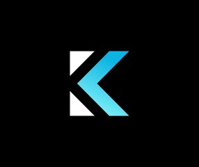

<!-- Reliable, High-Contrast Animated Hero Title (Never Breaks on GitHub) -->

<!-- Animated Subtitle in Exact Cyan-Mint Color (#5CE1E6) -->

 

<!-- Studio-Grade Flat Badges -->

  
  
  
  

---

### 🧭 Live Packages & Dispatch Hub

> Use **Direct APK** for the default universal build, or click **All Builds & Official** if you need specific architectures (ARM64, ARMv7, x86, TV, etc.).

| 🖼️ Logo | 📦 Application | ✨ Key Features & Details | 🔗 Direct APK | 🌐 Other Devices / Official |
| :---: | :--- | :--- | :---: | :---: |
|  | **Shiopa** Type: Streaming & Media Suite | Free streaming • Unlimited downloads • Built-in music player & TV remote • Liquid glass UI animations | [**`↓ Download APK`**](https://help.shiopa.com/dl/v1.1.8/Shiopa-v1.1.8.apk) | [**`↗ All Builds & Official`**](https://help.shiopa.com/docs/install) |
|  | **Nxsha** Type: Multi-Device Streamer | High-speed streaming engine • Full Android Phone, Android TV & Fire TV compatibility | [**`↓ Download APK`**](https://github.com/dev-alessiorizzo/nxsha-apk/releases/download/V2.6/Nxsha-v2.6-.Universal.apk) | [**`↗ All Builds & Official`**](https://nxsha.app/) |
|  | **Movie Stream** Type: Movies & Series Hub | Multi-language audio & subtitles • Crisp `1080p` HD streaming • Built-in 18+ / Adult mode toggle • Fast servers | [**`↓ Download APK`**](https://www.moviestream.bond/MovieStream-v1.0.162-build163-release.apk) | [**`↗ All Builds & Official`**](https://moviestream.bond/) |
|  | **CineDheu** Type: Regional & Global Cinema | Multi-language library • Smooth `1080p` playback • Dedicated Adult mode • Lightweight & fast UI | [**`↓ Download APK`**](https://github.com/code9xrs-hub/CineDheu/releases/download/v1.0.4/app-release.apk) | [**`↗ All Builds & Official`**](https://code9xrs-hub.github.io/CineDheu/#) |
|  | **Flixora** Type: Movies & Series Hub | Multi-language audio & subtitles • Crisp `1080p` HD streaming • Built-in 18+ / Adult mode • Fast servers | [**`↓ Download APK`**](https://github.com/shohanur2/FLIXORA-DOWNLOADS/releases/download/V1.0.14/FLIXORA-v1.0.14.apk) | [**`↗ All Builds & Official`**](https://flixora.app/) |
|  | **Hamyra** Type: Live TV, Movies & YT Suite | `200+` Live TV & sports channels • Built-in YouTube & YT Music • AI mood picks • Adult filter • Limited Hindi dub *(popular anime only)* | [**`↓ Download APK`**](https://github.com/Ibrahimkhalill/hamyra-releases/releases/download/v2.2/Hamyra.apk) | [**`↗ All Builds & Official`**](https://www.hamyra.xyz/app) |
|  | **Kurostream** Type: Anime & Streaming Hub | Best for anime • Smooth `1080p` HD playback • Multi-language sub & dub • Account login required | [**`↓ Download APK`**](https://github.com/MR-ABID07/Stream-X-/releases/download/v.01/Kurostream.apk) | [**`↗ All Builds & Official`**](https://kurostream.com/apk/) |
|  | **Netfly** Type: Movies & Series Hub | Crisp `1080p` HD streaming • Fast servers • English dub only *(Hindi dub unavailable)* | [**`↓ Download APK`**](https://github.com/samiulfaysal/NetFly-Apps/releases/download/v3.0.7/Netfly-v3.0.7-universal.apk) | [**`↗ All Builds & Official`**](https://github.com/samiulfaysal/NetFly-Apps/releases) |

---

<b>STREAM X</b> • Powered by <b>ABID</b> • Star ⭐ this repository to support future updates

